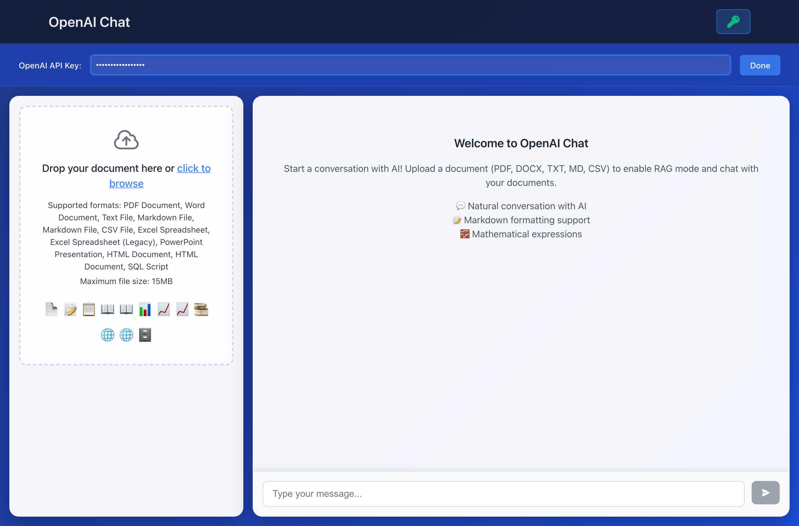
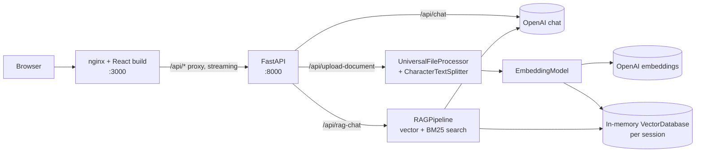
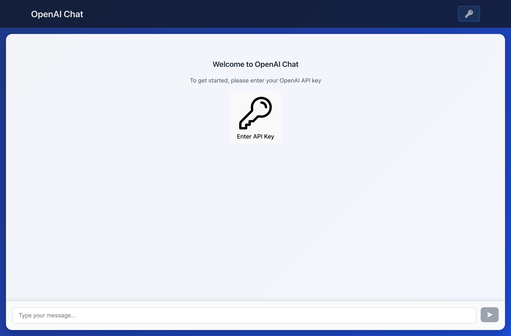
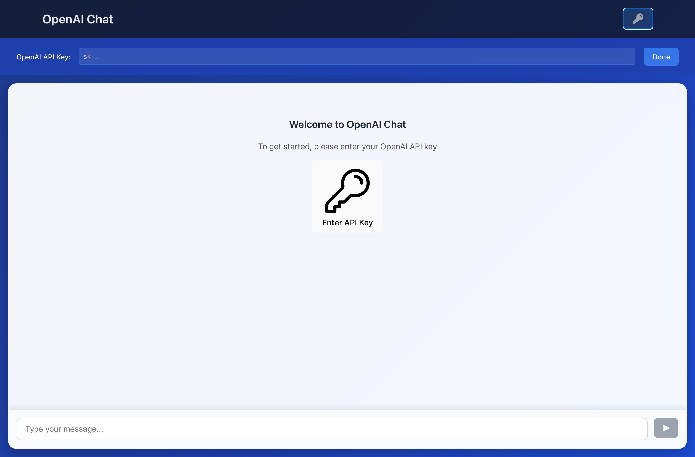
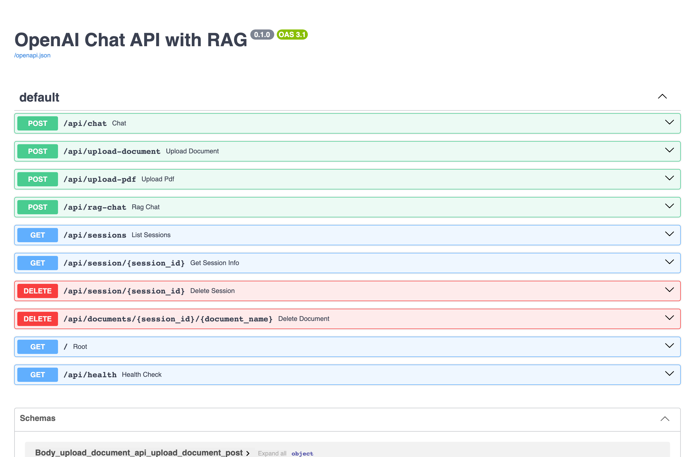
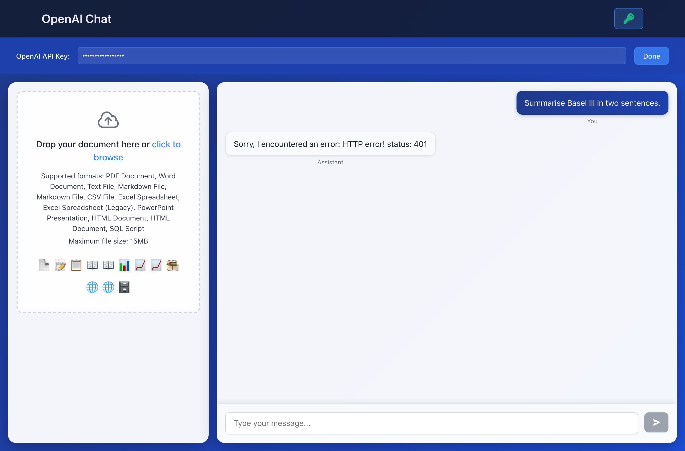

# OpenAI Chat with RAG

<p align="center"></p>

**Chat with OpenAI models, or upload your own documents and chat with them.**

A React (Vite) frontend and a FastAPI backend. The RAG pipeline (chunking, embeddings, an in-memory vector store and BM25) comes from the small `aimakerspace` library in this repo. It handles PDF, Word, Excel, PowerPoint, CSV, Markdown, HTML, SQL and text files.



---

## 1. The idea

Paste your OpenAI key in the browser and start chatting. Drop in a document and the next answers are grounded in it. The key is sent with each request and is never stored on the server.

## 2. Architecture

<p align="center"></p>



Sessions and vectors live in API memory, so restarting the container clears them.

## 3. Run it locally

```bash
cp .env.example .env              # optional: only the ports are read
docker compose up -d --build --wait
open http://localhost:3000        # UI: paste your OpenAI key with the key button
open http://localhost:8000/docs   # API docs
docker compose down
```

## 4. Screens

| State | Screenshot |
| --- | --- |
| First load, no key: the app asks for one |  |
| Key panel |  |
| Key entered: document upload panel |  |
| API docs |  |

### Model-dependent screens: not run

No real OpenAI key was used for these screenshots, so **no chat replies, uploads or RAG answers were generated**. The screenshot below uses an obviously fake key, and shows what the app really does when OpenAI rejects it: the API returns 401 and the UI shows the error.



## 5. Tests and CI

```bash
uv run --no-project --python 3.11 --with-requirements api/requirements.txt \
  --with-requirements requirements-dev.txt pytest -q tests/test_offline.py
```

`tests/test_offline.py` needs no key or network. It covers `/api/health`, request validation, the 401 for a rejected key (with OpenAI mocked) and the text splitter. GitHub Actions runs the tests, builds the frontend, then runs `docker compose build`.

Regenerate the screenshots with the stack running:

```bash
uv run --no-project --with playwright python scripts/screenshots.py
```

## 6. What changed for local use

- `Dockerfile` (API), `frontend/Dockerfile` + `frontend/nginx.conf` (static build, `/api` proxy with streaming), `docker-compose.yml`, `.env.example`.
- `/api/chat` now opens the OpenAI stream before responding. Before, a missing or invalid key returned an empty 200, so the UI showed nothing. It now returns a 401 with a clear message.
- The Vercel setup (`vercel.json`, `DEPLOYMENT.md`) is unchanged.

---

The original README is in [`docs/ORIGINAL_README.md`](docs/ORIGINAL_README.md).
